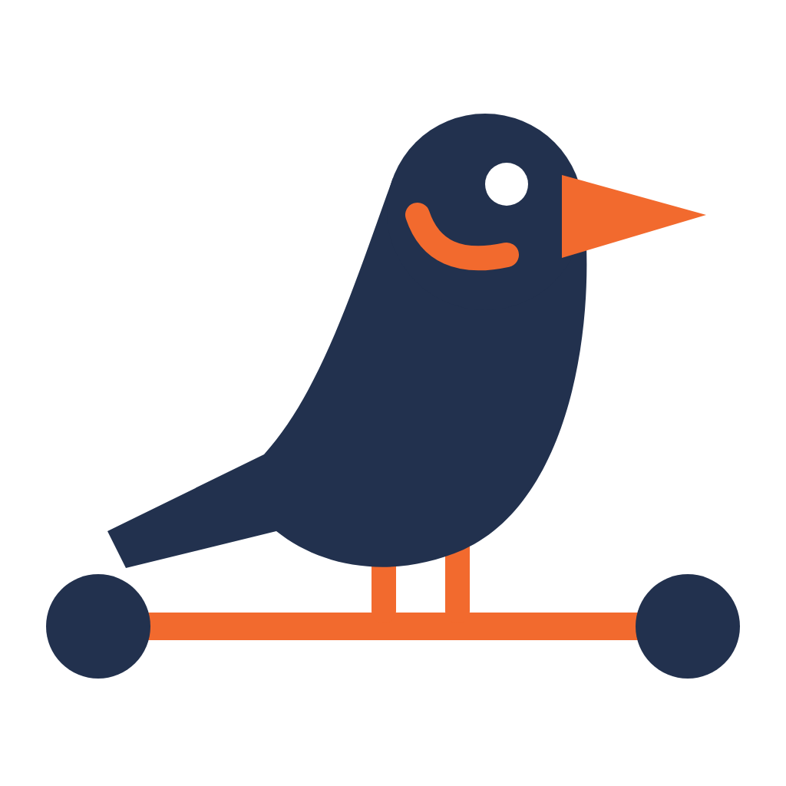

# swift-ros2

Native Swift client libraries for ROS 2. Publish, subscribe, and call services over **Zenoh** or **DDS** from Apple platforms, Linux, Windows, and Android, without cross-compiling the `rcl` / `rclcpp` stack and without a bridge. The API is Swift-native (`async`/`await`, `AsyncStream`, `Sendable`) and round-trip compatible with `rmw_zenoh_cpp` and `rmw_cyclonedds_cpp`.

## Packages

| Repository | What it provides |
| --- | --- |
| [swift-ros2](https://github.com/swift-ros2/swift-ros2) | The runtime: Zenoh, DDS, and RCL transports, contexts and nodes, publishers and subscriptions, services, actions, and parameters |
| [swift-ros2-rosidl](https://github.com/swift-ros2/swift-ros2-rosidl) | The interface layer: CDR serialization, message protocols, and the `swift-ros2-gen` code generator |
| [swift-ros2-common-interfaces](https://github.com/swift-ros2/swift-ros2-common-interfaces) | Generated Swift types for the standard messages (`sensor_msgs`, `geometry_msgs`, `std_msgs`, …) and `tf2_msgs` |
| [swift-ros2-extra-interfaces](https://github.com/swift-ros2/swift-ros2-extra-interfaces) | Generated Swift types for `control_msgs` and `moveit_msgs` |

[zenoh-pico](https://github.com/swift-ros2/zenoh-pico) and [cyclonedds](https://github.com/swift-ros2/cyclonedds) are forks of the Eclipse projects that the transports build on.

## Getting started

```swift
dependencies: [
    .package(url: "https://github.com/swift-ros2/swift-ros2.git", from: "3.1.2"),
    .package(url: "https://github.com/swift-ros2/swift-ros2-common-interfaces.git", from: "1.0.0"),
]
// target dependencies:
.product(name: "SwiftROS2", package: "swift-ros2"),
.product(name: "CommonInterfaces", package: "swift-ros2-common-interfaces"),
```

See the [swift-ros2 README](https://github.com/swift-ros2/swift-ros2#readme) for the quick start and the [Swift Package Index page](https://swiftpackageindex.com/swift-ros2/swift-ros2) for API documentation.

## About the logo



The logo is a mynah perched on a piece of a ROS 2 graph: the two navy circles are nodes and the orange line between them is the topic that connects them. A mynah can mimic human speech, and swift-ros2 lets Swift apps speak ROS 2 natively, talking to `rmw_zenoh_cpp` and `rmw_cyclonedds_cpp` peers on the wire without a bridge. A swift is a bird too, so a different bird nods to the language while keeping the mark our own. The artwork uses three flat colors: navy `#22314E`, orange `#F26A2E`, and white.

<br clear="left">

## Contributing

Issues and pull requests are welcome in each repository. The swift-ros2 packages are licensed under Apache 2.0.

---

<sub>ROS is a trademark of Open Source Robotics Foundation. Swift is a trademark of Apple Inc. This project is not affiliated with or endorsed by either organization.</sub>
